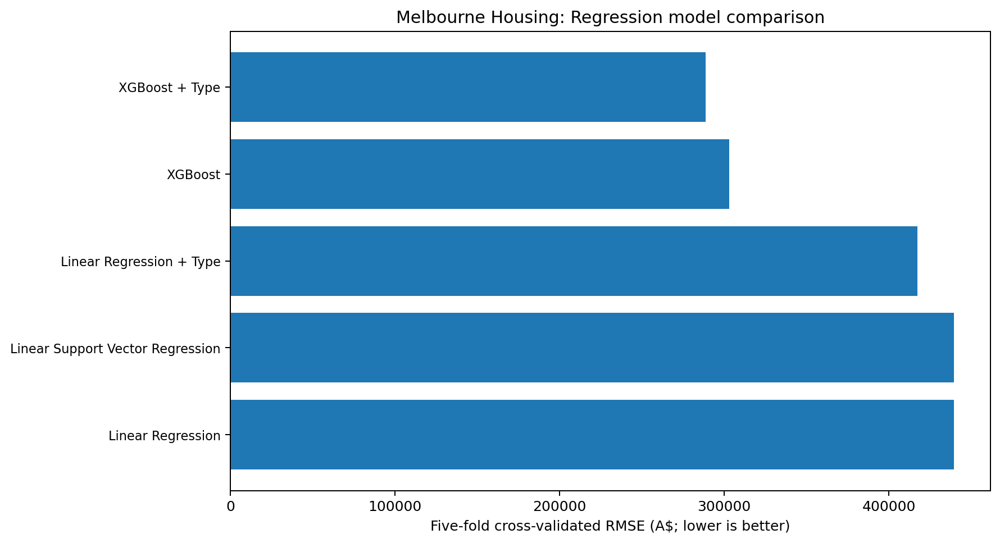

# Melbourne Housing Price Prediction

**Original project period:** January 2023 – June 2023  
**Technical revision and GitHub publication:** November 2026  
**Dataset period:** January 2016 – September 2017 (historical Melbourne transactions)

**Exploratory Data Analysis · Statistical Visualisation · Regression Modelling · Cross-Validation**

Originally undertaken between **January and June 2023**, this project examines historical Melbourne housing prices using Python-based exploratory data analysis and regression modelling. It was **technically revised in November 2026** for compatibility, reproducibility, stronger validation and public repository preparation; the original development dates are not GitHub commit dates.

An end-to-end Python analysis of **13,580 historical Melbourne property transactions** from the 2016–2017 *Melbourne Housing Snapshot* dataset. This repository retains the original detailed exploratory notebook (**269 cells: 126 Markdown and 143 code cells**), including its section order and visualisations, while correcting compatibility, calculation, and validation issues so the notebook executes cleanly.

> **Scope:** The data describe historical Melbourne property sales. This is a research/portfolio exercise, **not a live valuation system** and not a forecast for current Australian property prices.

## Research questions

- How do property prices vary with bedrooms, bathrooms, rooms, land and building area, property type, distance from Melbourne's CBD, and regional location?
- Which variables exhibit strong linear or nonlinear relationships with recorded sale prices?
- How do Linear Regression, linear Support Vector Regression, and XGBoost compare under the same validation procedure?
- Does including the property-type category improve predictive performance?

## Notebooks and figures

- [Complete, executed notebook](notebooks/Melbourne_Housing_Price_Prediction.ipynb)
- [Price distribution](images/price_distribution.png)
- [Geographical price distribution](images/geographical_price_distribution.png)
- [Regional comparisons](images/regional_property_comparison.png)
- [Model-comparison chart](images/model_comparison.png)



## Model results

The dataset is split 80% training (10,864 records) and 20% held-out testing (2,716 records), using `random_state=42`. All preprocessing is performed in pipelines **inside each training fold**; imputers and encoders are not fitted on test records. Five-fold shuffled K-Fold cross-validation selects the candidate with the **lowest mean validation RMSE**.

| Model | CV R² | CV RMSE (A$) | CV MAE (A$) |
|---|---:|---:|---:|
| Linear Regression | 0.524 | 439,714 | 274,181 |
| Linear Support Vector Regression | 0.524 | 439,712 | 274,174 |
| XGBoost | 0.775 | 303,010 | 185,278 |
| Linear Regression + Type | 0.573 | 417,504 | 260,467 |
| **XGBoost + Type** | **0.796** | **288,815** | **173,923** |

**Final held-out evaluation, once after selection:**

| Metric | XGBoost + property type |
|---|---:|
| R² | **0.8174** |
| RMSE | **A$269,347.86** |
| MAE | **A$172,488.79** |
| Baseline mean-price RMSE | A$630,259.30 |

These figures were reproduced by executing all 143 code cells using the supplied CSV. Small numeric differences can arise across versions or platforms; see the recorded validation summary. They differ from previously saved outputs because preprocessing, evaluation, and some model settings have been corrected. The SVR comparison uses **LinearSVR** for better numerical scalability, with standardised predictors and target. XGBoost uses reproducible fixed parameters; this project does not claim a comprehensive hyperparameter search.

## Getting started

1. Download `melb_data.csv` from the original [Kaggle Melbourne Housing Snapshot dataset](https://www.kaggle.com/dansbecker/melbourne-housing-snapshot/data). Alternatively, you can access it in data folder.
2. Place it at `data/melb_data.csv`. Do **not** replace it with a different Melbourne housing dataset; these results refer to the 13,580-row, 21-column snapshot.
3. Create a virtual environment and install the requirements:

   ```bash
   python -m venv .venv
   # Linux/macOS: source .venv/bin/activate
   # Windows PowerShell: .venv\Scripts\Activate.ps1
   pip install -r requirements.txt
   ```
4. Launch Jupyter and open the preserved notebook:

   ```bash
   jupyter lab notebooks/Melbourne_Housing_Price_Prediction.ipynb
   ```
5. Choose **Kernel → Restart Kernel and Run All Cells**. Run the notebook from the repository directory or the notebook's own directory; the loader checks both locations.

**Technical note:** Plotly's OpenStreetMap-based maps may require internet access to load background map tiles. The dataset, calculations and saved Matplotlib charts are local; no paid APIs or keys are required.

## What was corrected (2026 Update)

- Fixed CSV loading, missing-value handling and numeric-only correlation and aggregation operations for modern pandas.
- Corrected the dummy-variable joins, which previously vertically stacked unrelated columns and rows.
- Made z-score calculations NaN-safe; made outlier masking row-specific rather than replacing every matching value.
- Preserved the original exploratory visuals and discussions, with only targeted corrections for methodological accuracy and library compatibility.
- Separated descriptive data preparation from modelling, ensuring train-only imputation and category encoding.
- Added five-fold training-only cross-validation, reproducible algorithms, a mean-price baseline, and a single held-out evaluation.
- Re-executed every code cell; old cached outputs were replaced with results from the corrected pipeline.

## Methodological limitations

- Historical transactions span **January 2016–September 2017**. Random-split performance should not be interpreted as a future market forecast.
- The snapshot contains missing building and construction-year measurements, extreme property prices and possible recording inaccuracies.
- In exploratory plots, statistical outliers are masked for readability; the modelling pipeline starts from a separate original-data copy so legitimate large properties are not excluded using full-dataset outlier thresholds.
- High-cardinality address, suburb and agent text are not directly used in the existing models. This remains a useful area for future research.
- Correlations and model feature relationships are not evidence of causation.
- Some interactive Plotly maps depend on external map tiles when opened in a browser.

## Project chronology

| Period | Work documented |
|---|---|
| **January–June 2023** | Original exploratory housing-price analysis and initial machine-learning study. |
| **November 2026** | Compatibility and data-processing corrections; leakage-safe cross-validation and refreshed model metrics; GitHub repository packaging and documentation. |

The November 2026 validation metrics reflect the **revised** modelling workflow and should not be presented as the originally reported 2023 results. GitHub commits will display their actual 2026 creation dates; they have not been backdated.

## Dataset attribution, License and Citation

**Dataset:** [Melbourne Housing Snapshot](https://www.kaggle.com/dansbecker/melbourne-housing-snapshot), published on Kaggle by Dan Becker (DanB), based on Melbourne housing data originally compiled by Tony Pino.

The dataset is attributed to its original contributors and remains subject to the licensing terms specified by its provider. Further information about the dataset, its provenance and usage conditions is available in [data/README.md](data/README.md).

The original dataset is not included in this repository and can be obtained directly from Kaggle.

### Research Contributions:

This repository presents the data preprocessing, exploratory analysis, visualisations, machine-learning implementation and predictive modelling documented in the accompanying Jupyter notebook.

The analysis and supporting documentation are provided for academic reference, technical evaluation and research transparency. Original dataset ownership and any applicable third-party contributions remain acknowledged.

### License

The original source code and analytical implementation developed for this project are available under the [MIT licence](LICENSE), permitting reuse, modification and distribution in accordance with its terms. Third-party datasets remain subject to their respective licensing conditions.

### Citation

This research project was developed by Samudra De Silva. Researchers and practitioners referencing this work are encouraged to cite the repository using the information provided in [CITATION.cff](CITATION.cff).
